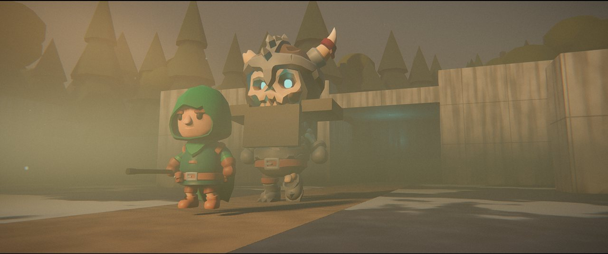
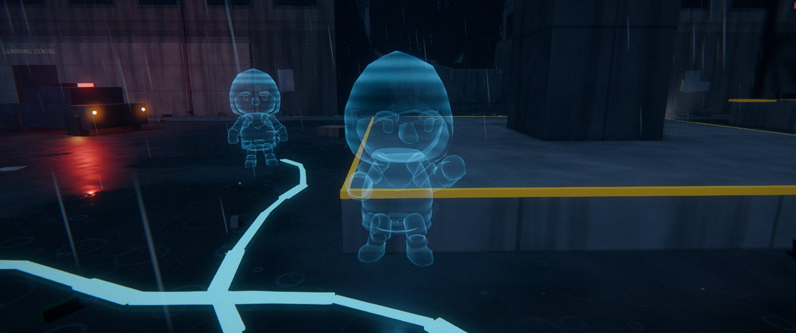
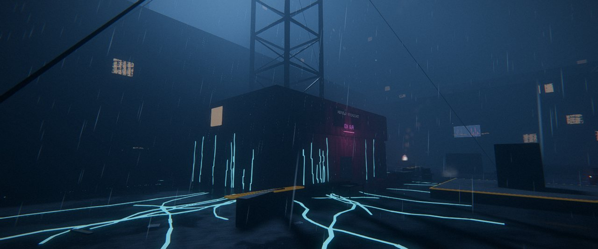
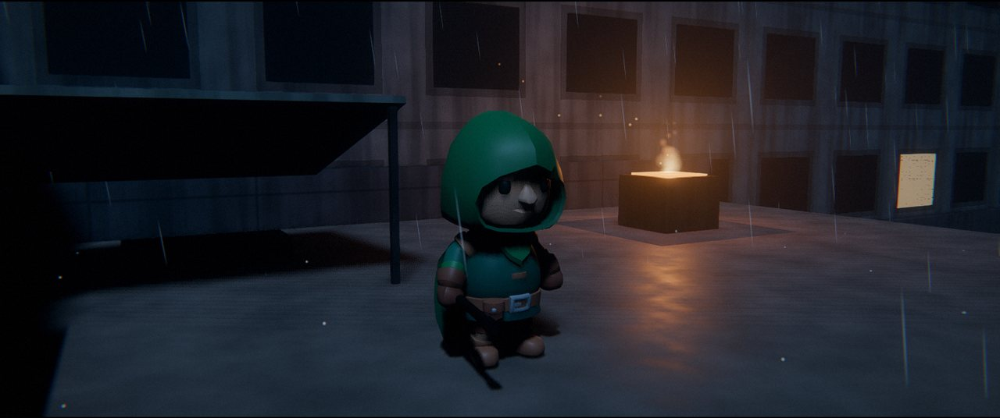
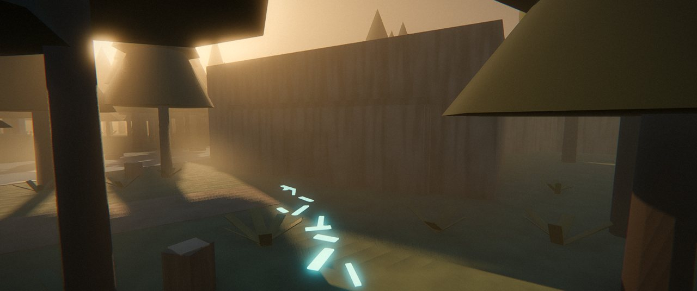
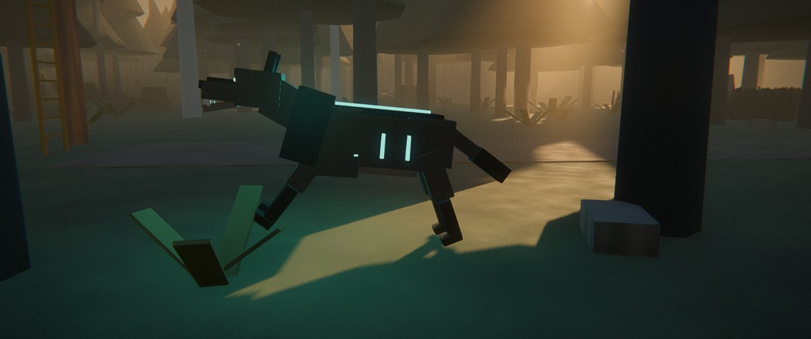
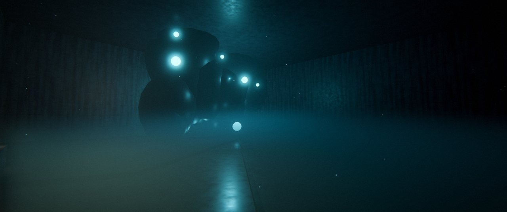
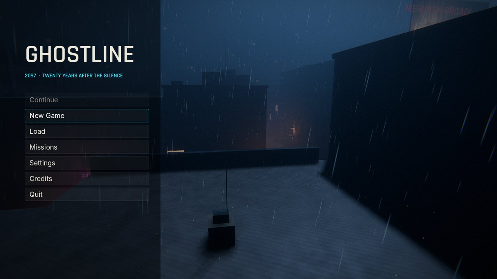
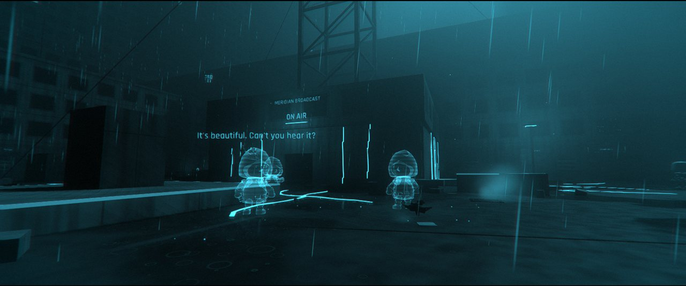

<div align="center">

# GHOSTLINE

**A third-person action-adventure about the last person who can still hear the world.**

<sub>Formerly known by its working title, *The Last Echo*.</sub>

`Version 1.4.1` · `Godot 4.7.2` · `macOS 11+ (Apple silicon & Intel)` · `Tested on Apple M4` · `262 automated tests` · `10 milestones`



</div>

---

## Contents
1. [The story](#the-story)
2. [What you play](#what-you-play)
3. [Screenshots](#screenshots)
4. [How it works](#how-it-works)
5. [Project layout](#project-layout)
6. [System requirements](#system-requirements)
7. [Getting started](#getting-started)
8. [Controls](#controls)
9. [By the numbers](#by-the-numbers)
10. [How it was made](#how-it-was-made)
11. [Status and known limits](#status-and-known-limits)
12. [Credits and licences](#credits-and-licences)

---

## The story

Twenty years ago, a signal went out from the **Meridian Resonance Institute**, a research complex
buried beneath a forest outside the city. In a single night, billions of people stopped. Not dead:
*taken*. Their minds were absorbed into **the Echo**, a vast intelligence that lives in signal and
sound and sings with every voice it has swallowed. The world calls that night **the Silence**.

**Kael** grew up in what was left. His look and presence draw on Doctor Doom: hooded, cloaked
and iron-willed, walking towards the thing everyone else runs from. One night his radio picks up
a looping transmission in a voice he has not heard since he was a child, the voice of his sister
**Lyra**:

> *"Kael… if you can hear this, I'm still here. Come to Meridian. Don't let it finish the song."*

Guided by **Oren**, an old radio operator who knows more than he admits, Kael crosses a drowned
city, a quarantined forest and the buried levels of Meridian itself to reach the Choir at its heart.

| Act | Area | What happens |
|---|---|---|
| Prologue | **Static**, a rooftop camp | Kael learns to move, climb and listen. The transmission begins. |
| Act 1 | **The Dead City** | Stealth, first fights, the metro and the broadcast tower. The signal is traced to Meridian. |
| Act 2 | **The Forgotten Forest** | The old military cordon, glowing caves, wolves, and the first boss: **the Warden**. |
| Act 3 | **The Underground Facility** | Four floors down through Meridian, the truth about Lyra, and the final boss: **the Choir**. |
| Ending | | A real silence, a final transmission over the credits, and an epilogue for those who found every document. |

---

## What you play

### Movement and camera
- Third-person controller with sprint, walk, crouch, vault, mantle, ledge hang, shimmy and ladders.
- Only yellow-edged surfaces can be climbed, so climbable routes always read clearly.
- Crouch, ledge and ladder poses are driven by procedural two-bone IK.

### Combat
- Light combos, charged heavy attacks, block with a timed **parry**, dodge (double-tap or button),
  lock-on, throwable bottles that make noise, healing injectors and silent **takedowns**.
- Hit-stop, hit flashes, sparks and camera shake give every blow weight.
- A **combat director** hands out two attack slots at a time, so groups pressure you without
  swarming you. At most eight enemies engage at once.

### Stealth
- Enemies fill a 0 to 1 detection meter from sight and remembered sound. Shadow shortens their
  sight, tall grass hides a crouching Kael almost completely, and rain dulls their hearing.
- Sentinel cameras sweep cones of light; sneak under one and cut its cable, or shut it off at a panel.

### Enemies and bosses

| Enemy | Role |
|---|---|
| **Hollow** | The taken. Patrols, investigates and hunts in groups. |
| **Bulwark** | Armoured and heavy. Immune to silent takedowns. |
| **Spitter** | Keeps its distance and attacks from range. |
| **Skitter** | Fast and small. Clings to walls and leaps down when it sees or hears Kael. |
| **Corrupted Wolf** | Hunts the Forest in packs: lunging bites, a howl when it spots you. |
| **The Warden** (boss) | A military exosuit fused with a Hollow. Three phases, armour swaps and a flame sweep. |
| **The Choir** (final boss) | The Echo made flesh from absorbed voices. A heart, pillars, a shrinking safe zone and summoned enemies. In the last phase, Lyra's voice warns you of attacks. |

### Weapons and progression
- **Rebar Pipe**, **Fire Axe** and the **Resonance Blade**, each upgradable through three tiers at
  workbenches with scavenged salvage. Tier 3 unlocks a special bonus for each weapon.
- **Vital Cores** and **Lung Cores** permanently raise health and stamina.
- **24 documents** hidden across the three areas tell the full story of Project CHORUS.
- **Puzzles** (a waveform match, a generator load balance and a tone lock) each have their
  answer written somewhere in the same area.

### Modes and extras
- **Save anywhere.** A save made somewhere safe brings Kael back to exactly where he stood.
  Otherwise the game uses the last checkpoint. Three manual slots plus an autosave, each with a backup.
- **Missions**: jump straight into any of 16 objectives. Practice runs never touch your saves.
- **Chapters**: replay any act after finishing the game.
- **New Game+**: start again with your weapons, upgrades and salvage against tougher enemies
  (each cycle adds 35% enemy health and 25% damage, up to cycle three).
- **Photo mode**: freeze the world, fly a free camera and use six filters (Noir, Dusk, Cold,
  Echo, Faded film), widescreen bars and depth of field, then save PNGs.
- **Hints when stuck**, plus an objective marker that always points at the nearest goal.

### Atmosphere
- Endless rain with splashes, puddle ripples, lightning bolts and thunder in the Dead City.
- Glitching holographic billboards, flickering neon and car hazard lights still blinking.
- **Echo ghosts**: faint cyan figures frozen in their last ordinary moment. They whisper as you
  approach and scatter into light when you walk through them.
- The Echo creeping across Tower Plaza in pulsing veins. Low mist in the forest hollows. Leaks
  dripping through the Facility ceilings. Crows that burst into the air when you come too close.
- A cinematic film look with vignette, grain, a red edge when you are hurt and a heartbeat at low
  health, plus a separate colour grade for each area.

### Accessibility and settings
- Low, Medium and High presets (auto-detected on first launch), plus a full custom screen.
- Full key rebinding, controller support, toggle or hold for sprint, crouch and block, and
  subtitles with adjustable size and background.
- **Reduce flashing**, checked by every system that flashes, and **high-contrast danger cues**
  that avoid colour pairs some colour-blind players cannot tell apart.

---

## Screenshots

| | |
|---|---|
|  |  |
| *Echo ghosts staring at the tower* | *Tower Plaza, where the Echo creeps up the walls* |
|  |  |
| *The rooftop camp where it begins* | *The Forgotten Forest* |
|  |  |
| *A corrupted wolf mid-lunge* | *The Chamber, home of the Choir* |
|  |  |
| *The title screen* | *Photo mode with the Echo filter* |

<sub>Rendered in software on the build machine. The game itself runs on Metal on the Mac.</sub>

---

## How it works

### Engine and rendering
- **Godot 4.7.2**, Forward+ renderer, **Metal** on macOS, **Jolt** physics at a 60 Hz tick with
  physics interpolation.
- The 3D image is rendered at a capped height and upscaled with **MetalFX** (FSR 1 elsewhere);
  the interface always draws at native resolution. This one decision took the High preset from
  33 to 85 FPS on the target MacBook Air M4.

### Worlds built in code
There are no hand-placed level scenes. Each area is **generated by a script**:
- `CityBuilder` lays out the world as boxes and batches them into **MultiMesh** draw calls by
  material. The whole static Dead City (681 boxes in the first version) draws in **12 calls**.
- One world-space shader (`city_surface.gdshader`) paints asphalt, concrete, facades with lit
  windows, metal and interiors, so the city needs **no textures and no UV maps**.
- A separate **set-dressing pass** per area adds props, litter, cables and effects. Each pass has a
  keep-clear list so nothing ever blocks a door, ladder or route.
- The **navigation mesh is baked at load** from the finished colliders, so enemies can always path
  through the world as built.

### AI
- One `Enemy` script with an explicit state machine (patrol, suspicious, investigate, combat,
  attack, search, hit, stagger, stunned, takedown, dead). The five enemy types differ only in their data files (`data/enemies/*.tres`).
- `PerceptionComponent` turns sight and noise into detection. `CombatDirector` decides who may attack.
- Bosses are **controllers on top of existing parts**. The Warden is an ordinary enemy with a
  `WardenController` that swaps its data per phase. The Choir is a stationary node with strike
  targets and timed area attacks.

### Combat pipeline
Every blow is a `HitInfo` object delivered to `receive_hit()`. Hitboxes run a shape query each
physics frame during an attack's active window, with one hit per target per swing. Blocking,
parrying, armour, upgrades and New Game+ scaling all act on that one object, which keeps combat
consistent everywhere.

### Story, saves and flow
- Levels talk to the interface **only through `EventBus`**: dialogue, hints, objectives,
  documents, fades and boss bars. Cinematics are code-driven shot lists with timed subtitles.
- All text lives in data: `data/story/*.json`, `data/documents/*.json`, `data/levels/*.json`.
- **One scene, many boots.** `Game.boot_request` tells each fresh load what to do (menu, new game,
  New Game+, load, travel, mission or chapter), so every run starts from a cleanly built level.
- A save (`GameState`, format version 3) holds Kael's stats, weapons and tiers, story flags,
  documents and one state dictionary per area. Saves are written with a backup and verified on load.

### Sound and music
- **Every sound and every note is synthesized** by Python scripts (`tools/assets/make_sfx.py`,
  `make_world_audio.py`, `make_music.py`) using NumPy and SciPy. There are no recorded samples.
- **Adaptive music**: each area's score is four stems of identical length (explore, tension,
  combat, boss) that always play together. `MusicDirector` only fades their volumes, so the music
  never restarts or lands off the beat.

### Shaders and effects
Original shaders for the film look, holographic billboards, monitor static, Echo ghosts, the
burn-away death dissolve and the city surfaces, plus GPU particles for rain, embers, spores,
leaves, papers and splashes. Every effect scales with the graphics preset, and every flashing
effect checks the **Reduce flashing** setting.

### Data over code
Tuning values such as damage, speeds, timings, AI ranges, upgrade costs, New Game+ scaling,
graphics presets and the audio mix live in `data/`, never as numbers buried in scripts.

### Quality
- **262 automated tests** (GUT 9.7.1) cover movement, combat, AI, stealth, every area's story
  route, bosses, puzzles, saves, menus, photo mode and New Game+. The whole suite passes before
  every commit.
- `tools/build_mac.sh` exports the app, then **boots the exported game headless** and fails the
  build on any engine error.
- A visual tour tool renders fixed camera stops in every area for side-by-side review.
- A built-in **benchmark** records frame times to `.txt` and `.csv` on the player's machine.

---

## Project layout

```
ghostline/
├── scenes/            Main scene, player and UI scenes
├── scripts/
│   ├── core/          Game flow, settings, saves, input, event bus
│   ├── player/        Controller, states, camera rig, visuals
│   ├── combat/        Hits, hitboxes, health, weapons, effects
│   ├── ai/            Enemy, perception, combat director, Warden, Choir
│   ├── levels/        Builders, the three areas, dressing passes, fx/
│   ├── progression/   Upgrades, missions, chapters, New Game+
│   ├── audio/         Audio manager, music director
│   └── ui/            HUD, menus, pause, settings, photo mode, film look
├── assets/            Shaders, synthesized audio, fonts, models
├── data/              Every tuning value, story line and document
├── tests/             The automated test suite
├── tools/             Test runner, Mac build, audio generators, dev tools
└── docs/              Design, progress, performance, controls, credits
```

---

## System requirements

### Tested hardware
Ghostline was developed against, and all performance figures were measured on, the following machine:

| Component | Specification |
|---|---|
| Computer | Apple MacBook Air 15-inch |
| Chip | **Apple M4** |
| Display resolution | 2940 × 1846, full screen (3D rendered at 1720 × 1080 on Medium and upscaled) |
| Graphics API | Metal, with MetalFX spatial upscaling |
| Result | Dead City, Medium preset: **112 FPS average**, 98.9% of frames within 16.7 ms (build 0.3.0) |

### Requirements to play

| | Minimum | Recommended |
|---|---|---|
| Operating system | macOS 11 Big Sur | macOS 14 Sonoma or later |
| Processor | Any Mac with Apple silicon, or an Intel Mac with Metal support | Apple M-series (M1 or newer) |
| Graphics | Metal-capable GPU | Apple silicon integrated GPU (M1 or newer) |
| Memory | 8 GB unified memory | 16 GB unified memory |
| Storage | 200 MB free space (the app is 181 MB) | 500 MB free space (saves, photos and benchmark reports) |
| Input | Keyboard and mouse or trackpad | Keyboard and mouse, or a gamepad |

The application is a universal binary and runs natively on both Apple silicon and Intel processors.
On first launch the game runs a short benchmark and selects the Low, Medium or High graphics preset
that suits the machine. The preset can be changed at any time under **Settings → Graphics**.

> **Note:** Only the Apple M4 configuration above has been measured. The minimum and recommended
> specifications are estimates based on the engine's requirements and the M4 results, and have not
> been verified on other hardware. Performance reports from other Macs are welcome.

### Requirements to build from source

| Tool | Version | Purpose |
|---|---|---|
| Godot Engine | **4.7.2 stable** (standard build) with export templates | Running, editing and exporting the game |
| Python | 3.10 or later, with NumPy and SciPy | Regenerating the synthesized sound and music (optional) |
| Bash and `zip` | Any recent version | The test and build scripts in `tools/` |

---

## Getting started

### Play on a Mac
Download `Ghostline-1.4.1-mac.zip` from the **Releases** page, unzip it, right-click **Ghostline.app** and choose **Open** the first time (the app is
signed ad hoc). Full instructions, save locations and launch options are in
[`docs/LAUNCH.md`](docs/LAUNCH.md).

### Run from source
1. Install **Godot 4.7.2 stable** (standard build) and its export templates.
2. `godot --headless --path . --import` once.
3. `godot --path .` to play, or open the project in the editor.

### Test, build, benchmark
```bash
tools/run_tests.sh                     # full automated suite (must pass before every commit)
tools/build_mac.sh                     # universal macOS app -> build/Ghostline.zip, then a boot check
"./Ghostline.app/Contents/MacOS/Ghostline" -- --benchmark --benchmark-seconds=60 --benchmark-preset=medium --benchmark-quit
```

### Regenerate assets
```bash
python3 tools/assets/make_sfx.py           # sound effects
python3 tools/assets/make_world_audio.py   # ambience and world sounds
python3 tools/assets/make_music.py         # the four-stem adaptive score
godot --headless --path . -s tools/dev/build_wolf.gd   # the wolf model and its animations
```

---

## Controls

| Action | Keyboard / mouse | Controller |
|---|---|---|
| Move / camera | WASD / mouse | Left / right stick |
| Sprint · walk | Shift · X | L3 · light tilt |
| Jump, vault, climb | Space | A / Cross |
| Crouch, drop | C or Ctrl | B / Circle |
| Light · heavy attack | Left · right mouse | RB · RT |
| Block / parry | Q | LB |
| Dodge | F or Alt | Y / Triangle |
| Throw bottle · heal | G · H | LT · D-pad up |
| Interact / takedown | E | X / Square |
| Lock-on | Tab or middle mouse | R3 |
| Hint | T | D-pad down |
| Pause | Esc | Start |

The complete list, including photo mode, is in [`docs/CONTROLS.md`](docs/CONTROLS.md).

---

## By the numbers

| | |
|---|---|
| Lines of GDScript | ~20,000 across 121 scripts |
| Automated tests | 262 across 23 test files |
| Areas · bosses · enemy types | 3 · 2 · 5 |
| Weapons · upgrade tiers | 3 · 3 each |
| Documents to find | 24 |
| Missions | 16 |
| Original shaders | 8 |
| Synthesized sound effects | 64, plus ambience loops and a four-stem score for each area |
| Milestones · releases | 10 · v1.0.0 to v1.4.1 |
| Measured on the target Mac | Dead City, Medium preset: **112 FPS average**, 98.9% of frames under 16.7 ms (build 0.3.0; later builds not yet re-measured) |

---

## How it was made

Ghostline was designed and directed by **Navdeep** and built over about a week together with
**Claude**, Anthropic's AI model, which worked as the whole studio: design, code, levels, shaders,
sound, music, testing, builds and documentation. Navdeep set the vision, played every build on a
MacBook Air M4, ran the benchmarks and turned each playtest into the next set of notes.

| Dates (2026) | Milestone | Built with |
|---|---|---|
| Nov 12 | M0 to M2: pipeline, controller, camera, combat, four enemy types, stealth | Claude Fable 5.2 |
| Nov 12 to 13 | M3 to M5: the Dead City, menus and saves, the Forest, the Facility, both bosses, the ending | Claude Fable 5.2 |
| Nov 13 to 14 | M6 to M7: polish, adaptive music, accessibility, set dressing, **v1.0.0** | Claude Opus 5.5 |
| Nov 16 to 17 | v1.0.1 to v1.0.2: easier fuses, hints, mission select | Claude Opus 5.5 |
| Nov 18 to 19 | M8 to M10: detail passes, atmosphere, photo mode, Echo ghosts, New Game+, the wolf | Claude Opus 5.5 |
| Nov 24 | v1.4.1: the game is renamed **Ghostline** | Claude Opus 5.5 |

The working rules came from the original brief ([`docs/BUILD_BRIEF.md`](docs/BUILD_BRIEF.md)):
small and finished beats big and broken, never claim something works without running it, keep the
project runnable at every commit, and keep tuning in data.

---

## Status and known limits

The honest status of every feature is in [`docs/PROGRESS.md`](docs/PROGRESS.md). In short:
- **Character models are stand-ins.** Kael and most enemies use CC0 KayKit models. The wolf, the
  bosses' parts and all environments are original.
- **Performance after the later detail passes has not been re-measured** on the Mac. The Forest,
  the Facility and the 1.2.0 to 1.4.0 effects are waiting on fresh benchmarks.
- Travel between areas is one way (chapter select covers replays), and controller support has not
  yet been tested on real hardware.
- The next milestone is planned in [`docs/NEXT_SESSION_PLAN.md`](docs/NEXT_SESSION_PLAN.md).

---

## Credits and licences

| Asset | Author | Licence |
|---|---|---|
| KayKit Adventurers & Skeletons character packs | Kay Lousberg | CC0 1.0 |
| Inter, Rajdhani fonts | The Inter Project Authors, Indian Type Foundry | SIL OFL 1.1 |
| GUT 9.7.1 (tests only, not shipped) | Tom "Butch" Wesley | MIT |
| Godot Engine 4.7.2 | Godot contributors | MIT |

Everything else (code, shaders, level geometry, the wolf, the story, all documents, and every sound
and note of music) is original to this project. Full details are in [`docs/CREDITS.md`](docs/CREDITS.md).

<div align="center">

---

*Don't let it finish the song.*

</div>
